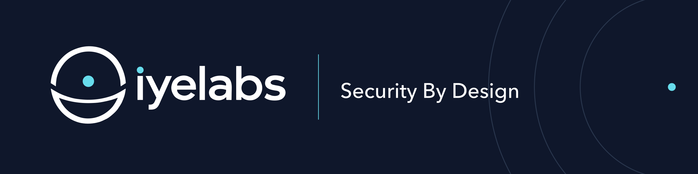

  

**iyelabs** is a cybersecurity company building security products through research and engineering.

We approach security as a design discipline. Our work spans product development and tools for the security community.

We’re developing our products behind the scenes and sharing selected projects along the way.

### Community

**ZeroWire Companion**  
Read-only security briefings and source-linked vulnerability context through MCP.

[Explore the project](https://iyelabs.com/#community)

### Stay connected

[Website](https://iyelabs.com) · [LinkedIn](https://www.linkedin.com/company/iyelabs) · [Email](mailto:hi@iyelabs.com)

To report a vulnerability, please see our [security policy](https://github.com/iyelabs/.github/blob/main/SECURITY.md).
